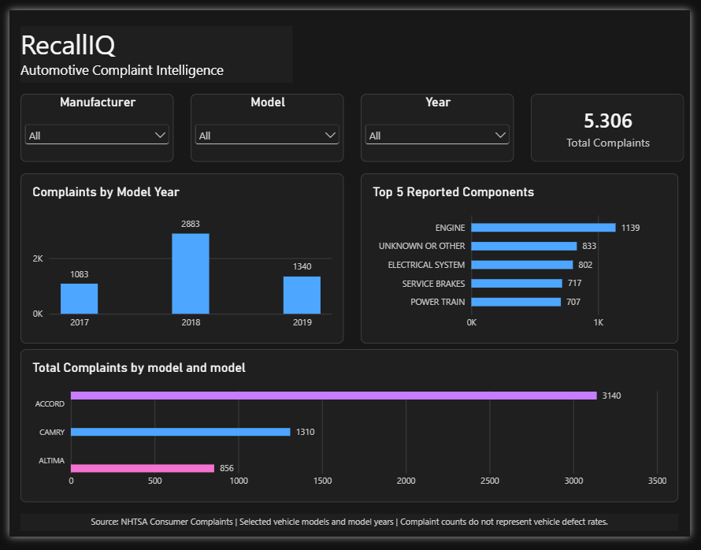

# Vehicle Complaint Analytics

### Automotive Safety Data Analytics | Python, PostgreSQL & Power BI

## Overview

An end-to-end data analytics project using public vehicle
complaint records from the US National Highway Traffic
Safety Administration (NHTSA).

The project explores reported safety issues across
three comparable midsize sedans:

- Toyota Camry
- Honda Accord
- Nissan Altima

Model years: 2017, 2018 and 2019.

## Technologies

- Python: API ingestion, data cleaning and validation
- PostgreSQL: data storage
- SQL: analytical queries and reporting views
- Power BI: interactive dashboard and DAX measures
- unittest: automated testing
- Git and GitHub: version control

## Data Pipeline

NHTSA API
    |
    v
Python Data Ingestion
    |
    v
Data Quality Checks & Cleaning
    |
    v
PostgreSQL Database
    |
    v
SQL Analytical Views
    |
    v
Power BI Dashboard

## Key Features

- Automated collection of public complaint records
- Detection of missing and duplicate identifiers
- Duplicate-safe PostgreSQL imports
- Logging and database error handling
- Automated unit tests
- Component-level complaint analysis
- Interactive filtering by manufacturer, model and year

## Dashboard

The dashboard allows users to explore:

- Total complaint records
- Complaint counts by model year
- Top reported components
- Complaint counts by vehicle model
- Component reporting percentages

## Running the Project

Install dependencies:

    pip install -r requirements.txt

Create a PostgreSQL database named `recalliq`.

Run these SQL scripts in pgAdmin:

1. `sql/01_schema.sql`
2. `sql/02_views.sql`

Fetch and import vehicle complaints:

    python src/main.py --make toyota --model camry --year 2018

Enter the PostgreSQL password when prompted.

Run `sql/03_analysis.sql` for additional analysis.

Run tests:

    python -m unittest discover -s tests -v

## Data Source

NHTSA Consumer Complaint Records (United States).

https://www.nhtsa.gov/nhtsa-datasets-and-apis

## Limitations

Complaint counts are not vehicle defect rates.

The dataset contains submitted consumer reports, not
all vehicle failures. Differences in vehicle population,
usage, reporting behaviour and time on the road affect
comparisons.

The results should not be interpreted as vehicle
reliability rankings.

## Project Status

Portfolio project — Version 1.0
